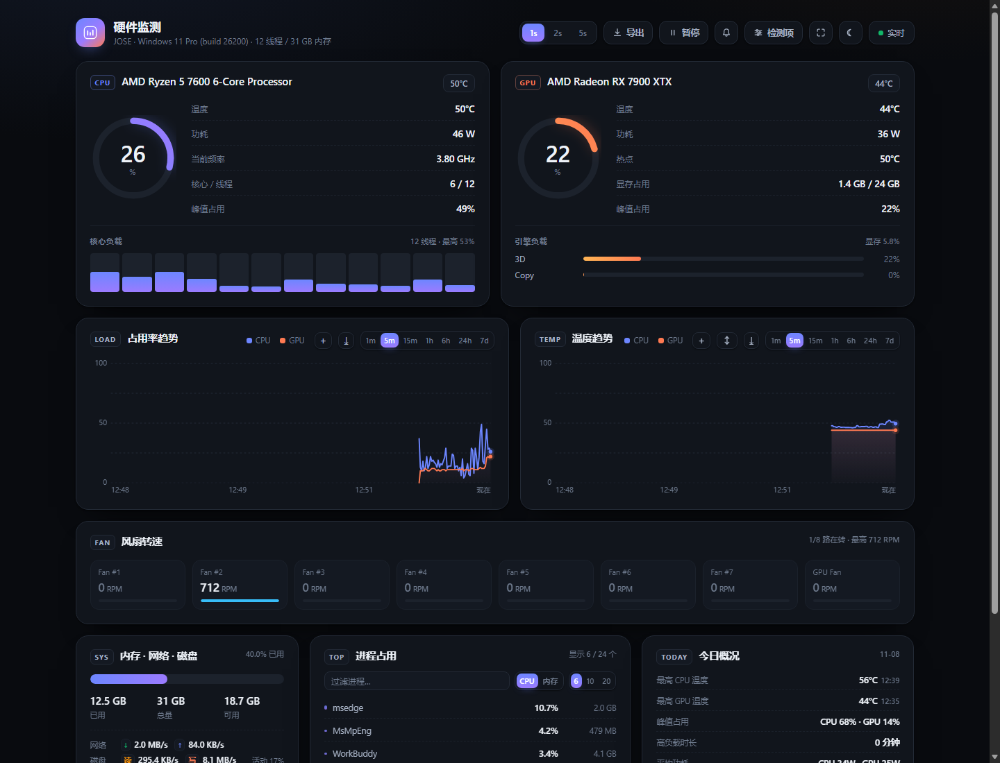
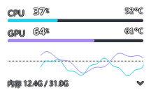
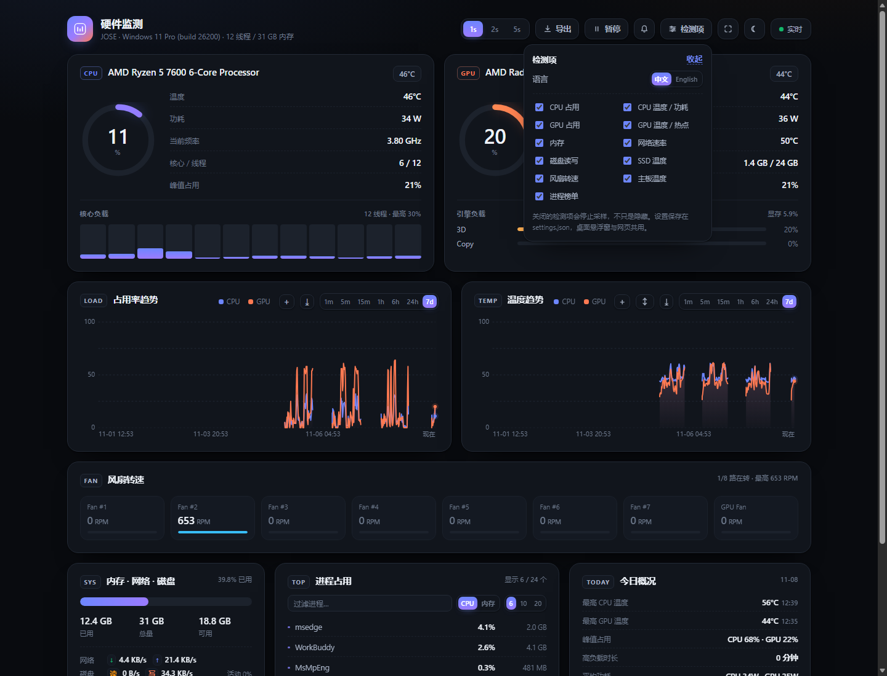

# CPU / GPU 监视器

一个常驻 Windows 桌面的硬件监测器：**一块可以拖到任何角落的悬浮窗**，加上一个 **本地网页仪表盘**。单进程、离线、不需安装运行时，双击一个 exe 就能用。

<p align="center">
  
</p>

<p align="center">
  
  &nbsp;&nbsp;
  
</p>

## 它是什么

- **悬浮窗**：216×130，置顶、可拖动、半透明，右键菜单调字号/透明度/趋势图/检测项/语言。平时就压在桌面角落，不抢焦点。
- **网页面板**：`http://127.0.0.1:8770`，实时曲线、每核负载、内存/网络/磁盘、风扇、进程榜、今日概览。手机连同一局域网也能看（需显式开 `--lan`）。
- **历史**：每 5 秒落一行，保留 14 天；面板可以回看 1h / 6h / 24h / 7d，按 720 个桶降采样，不会把浏览器画卡。
- **中英切换**：桌面端与网页端共用一份设置，改哪边另一边立刻跟着变。
- **检测项独立开关**：CPU / CPU 温度 / GPU / GPU 温度 / 内存 / 网络 / 磁盘 / SSD 温度 / 风扇 / 主板 / 进程，共 11 项。**关掉的项会停止采样**，不是把数字藏起来。

## 快速开始

要求：Windows 10 / 11，系统自带 .NET Framework 4.x。

```powershell
# 1. 取代码：git clone 本仓库，或直接下载 ZIP 解压
cd cpu-gpu-monitor

# 2. 编译：只用 Windows 自带的 csc.exe，不需要装 SDK
powershell -ExecutionPolicy Bypass -File tools\build-widget.ps1

# 3. 运行
.\bin\CPU-GPU监视器.exe
```

启动后悬浮窗出现在屏幕右上角，浏览器打开 **http://127.0.0.1:8770**（端口被占会自动往上找，最多试 30 个）。

**关于温度**：占用率、频率、内存、网络、磁盘都不需要特殊权限；**CPU 温度需要管理员权限**（要加载内核驱动读 MSR），所以首次启动会请求提权，拒绝也能用，只是 CPU 温度显示 `—`。温度数据来自 [LibreHardwareMonitor](https://github.com/LibreHardwareMonitor/LibreHardwareMonitor) 的 `LibreHardwareMonitorLib.dll`，程序按以下顺序找它：

1. `%LOCALAPPDATA%\Programs\LibreHardwareMonitor\`
2. exe 同目录 / 上一级目录
3. `C:\Program Files\LibreHardwareMonitor\`

装一份 LibreHardwareMonitor 就能解锁 CPU / 主板 / SSD / 风扇温度。没装也不会崩：自动降级为「无温度」，其余功能照常。

## 面板里有什么

| 区域 | 内容 |
| --- | --- |
| CPU | 总占用环、每核负载条、频率、功耗、温度、核心/线程、峰值 |
| GPU | 占用环、温度、热点、功耗、显存、3D/Copy 引擎占用 |
| 趋势 | 占用与温度双图；1m / 5m / 15m 走内存环，1h / 6h / 24h / 7d 读磁盘归档 |
| 系统 | 内存、网络上下行、磁盘读写与活动率 |
| 风扇 | 每个风扇头的转速，转起来的会高亮 |
| 进程 | 按 CPU / 内存排序的 Top 榜 |
| 今日 | 当日最高温度、峰值占用、高负载累计时长 |

其它：深浅色主题（默认跟随系统）、图表导出 PNG、数据导出 CSV、暂停刷新、全屏看板、阈值告警与桌面通知、PWA manifest（localhost 下可加到桌面）。前端是原生 JS，没有任何 CDN 依赖，断网也能开。

## 右键菜单

字体大小、背景透明度、完全透明背景（只留文字）、趋势图、内存行、总在最前、**检测项**（11 个勾选项）、**语言 / Language**、打开网页面板、以管理员身份重启、退出。

设置写在 `desktop\settings.json`，外观写在 `desktop\widget-config.json`，都是纯文本，删掉即恢复默认。

## 命令行

| 参数 | 说明 |
| --- | --- |
| `--panel` / `--no-panel` | 强制开启 / 关闭网页面板 |
| `--port <n>` | 面板起始端口，默认 `8770` |
| `--lan` | 监听 `0.0.0.0`，允许局域网访问（**无鉴权**，见下） |
| `--no-elevate` | 不提权启动（调试用，CPU 温度会缺） |
| `--interval-ms <n>` | 采样间隔，默认 `1000` |
| `--font-size <px>`、`--alpha <0..1>` | 覆盖悬浮窗外观，仅本次有效 |
| `--data-dir <path>` | 历史与日志目录，默认 `data\` |
| `--headless` | 只起 HTTP 服务、不建窗口（CI / 无桌面环境） |
| `--autoclose <秒>` | 到点自动退出 |
| `--selftest` | 用假数据渲染默认/浅色/折叠三种帧，写到 `desktop\selftest*.png` |
| `--diag` / `--smoke` / `--capture` | 诊断、冒烟、桌面合成截图 |

## 数据与隐私

- 所有数据都在本机，程序不发起任何外部网络请求，没有遥测、没有账号。
- `data\history-YYYY-MM-DD.ndjson`：每行十几个数字（占用、温度、功耗、速率），不含进程名。
- `data\spikes-YYYY-MM-DD.log`：CPU 超过 70% 时记一行，**含当时的进程名**；分享 `data\` 前留意一下。
- 日志 `desktop\widget.log` 只记启动、端口、异常，不记录你在用什么软件。
- 历史保留 14 天，跨天时自动清理旧文件。

## 安全说明

默认只监听 `127.0.0.1`，只有本机能访问。

`--lan` 会绑定 `0.0.0.0` 且**没有任何认证**——同一网段的任何人都能看到你的硬件数据。面板顶部会显示红色警示条。只在你信任的网络里用，用完记得关；不要把端口映射到公网。

## 已知限制

- 仅 Windows（WinForms + PDH + .NET Framework）。
- CPU 温度依赖 LibreHardwareMonitor 与管理员权限；部分笔记本/品牌机的传感器本来就不暴露。
- 风扇、主板、SSD 温度取决于硬件是否有对应传感器；显卡热点不是所有型号都读得到。
- 历史固定 5 秒粒度、保留 14 天，不是时序数据库，也不适合做长期容量规划。
- 单实例运行；`--lan` 无鉴权；没有自动更新和安装包。

## 开发

```
desktop\
  Widget.cs     窗口、采样、右键菜单、设置、自检（约 2.9k 行）
  Panel.cs      HTTP 服务、历史归档、SSE、设置接口（约 2k 行）
web\            仪表盘：index.html / app.js / i18n.js / style.css，无构建步骤
tools\          build-widget.ps1（编译）、smoke-test.ps1（端到端）、gen-icons.py
docs\           截图
```

**编译**：`tools\build-widget.ps1` 直接调用 `%WINDIR%\Microsoft.NET\Framework64\v4.0.30319\csc.exe`，所以代码必须停在 **C# 5**——不要用字符串插值、`?.`、`out var`、自动属性初始化器，lambda 捕获也尽量换成 `delegate { }`。这样用户不需要装 SDK 或 Visual Studio。

需要 IDE 调试时打开 `CPU-GPU-Monitor.sln`（输出同样落到 `bin\`）；两种构建产物路径一致。

**测试**：

```powershell
# 渲染三张自检图，验证绘制与布局
.\bin\CPU-GPU监视器.exe --selftest --no-elevate

# 起一个临时实例，跑完 8 项接口检查后自动退出
powershell -ExecutionPolicy Bypass -File tools\smoke-test.ps1
```

CI 在 Windows runner 上跑这两步，并额外用 MSBuild 编译一遍 solution，确认代码没有偷偷依赖 csc 的宽松行为。

**接口**：`/api/ping`、`/api/info`、`/api/snapshot`、`/api/settings`（GET/POST）、`/api/history`（`?range=1h|6h|24h|7d`）、`/api/summary`、`/api/stream`（SSE）。所有响应都是手写 JSON，没有序列化框架。

## 许可

[MIT](LICENSE)。温度读取在运行时反射加载 [LibreHardwareMonitorLib](https://github.com/LibreHardwareMonitor/LibreHardwareMonitor)（MPL-2.0），本仓库不包含它的代码或二进制。

---

## English

A small Windows hardware monitor: a draggable always-on-top widget plus a local web dashboard, in **one process** with no installer, no background service and no external requests.

- **Widget**: 216×130, top-most, semi-transparent, right-click for font size, opacity, trend graph, per-sensor switches and language.
- **Dashboard**: `http://127.0.0.1:8770` — live charts, per-core load, memory / network / disk, fans, top processes, today's summary. Ships a PWA manifest for localhost use.
- **History**: one row every 5 s, kept for 14 days; the panel can look back 1h / 6h / 24h / 7d (downsampled to 720 buckets).
- **Bilingual**: Chinese / English, shared between the widget and the dashboard.
- **11 independent sensor switches**: turning one off stops sampling it, it does not just hide the number.

**Build & run** (Windows 10/11, .NET Framework 4.x — nothing else):

```powershell
powershell -ExecutionPolicy Bypass -File tools\build-widget.ps1
.\bin\CPU-GPU监视器.exe
```

CPU temperature needs administrator rights and a local [LibreHardwareMonitor](https://github.com/LibreHardwareMonitor/LibreHardwareMonitor) installation; usage, clocks, memory and I/O work without either. The panel binds to loopback only — `--lan` exposes it on the network **without authentication**.

Licensed under the [MIT License](LICENSE).
